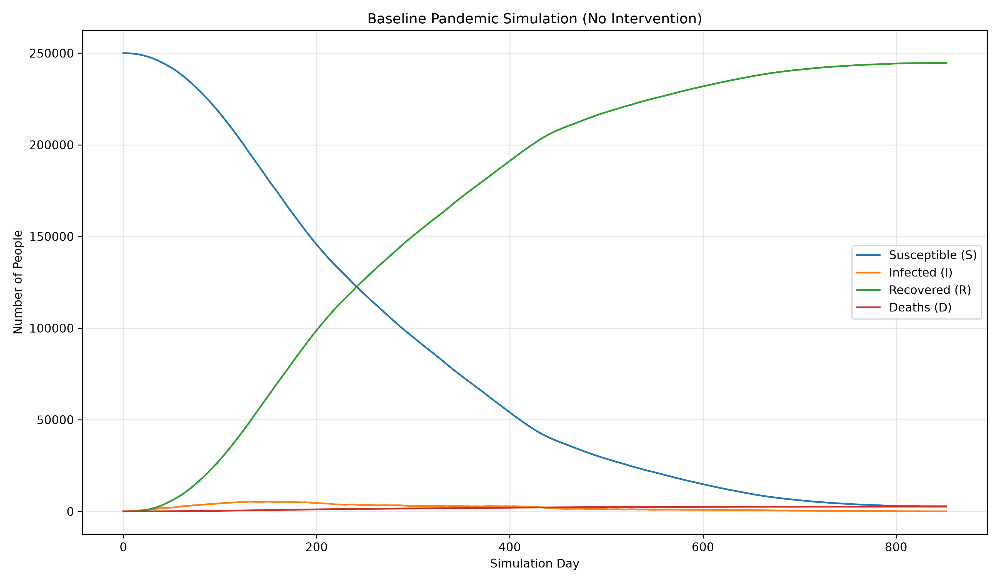
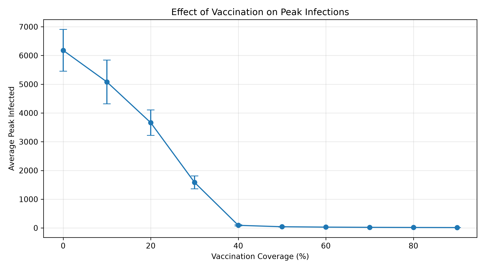
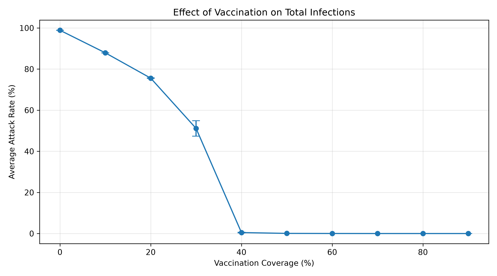
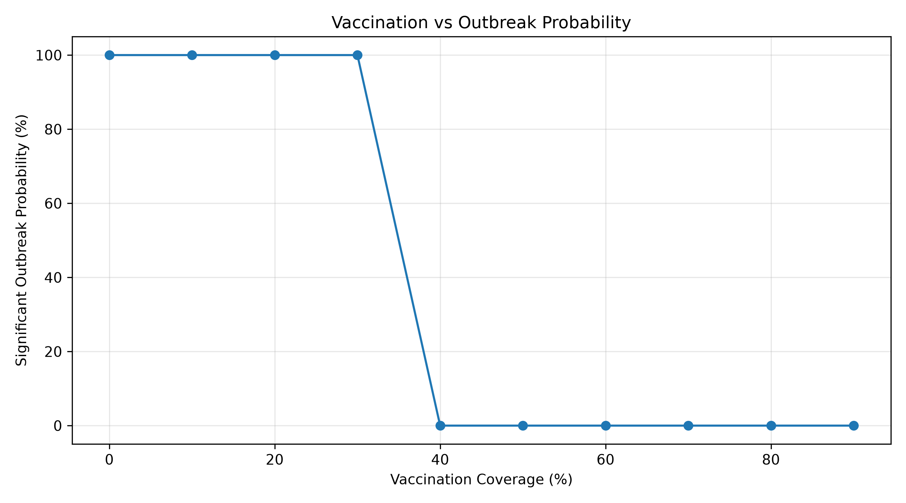
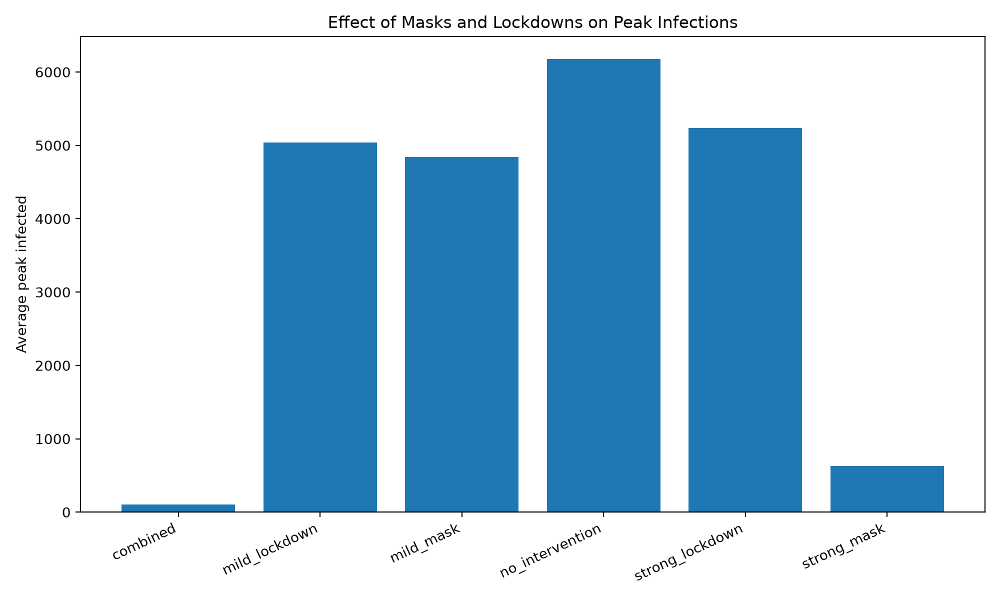
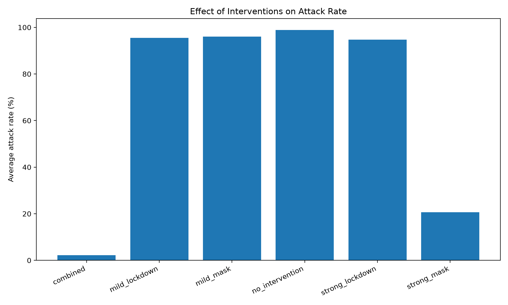
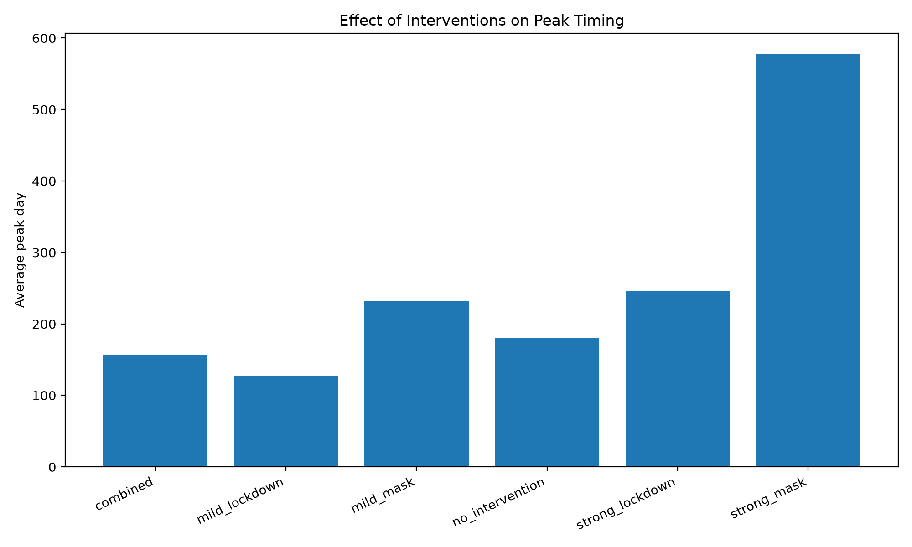
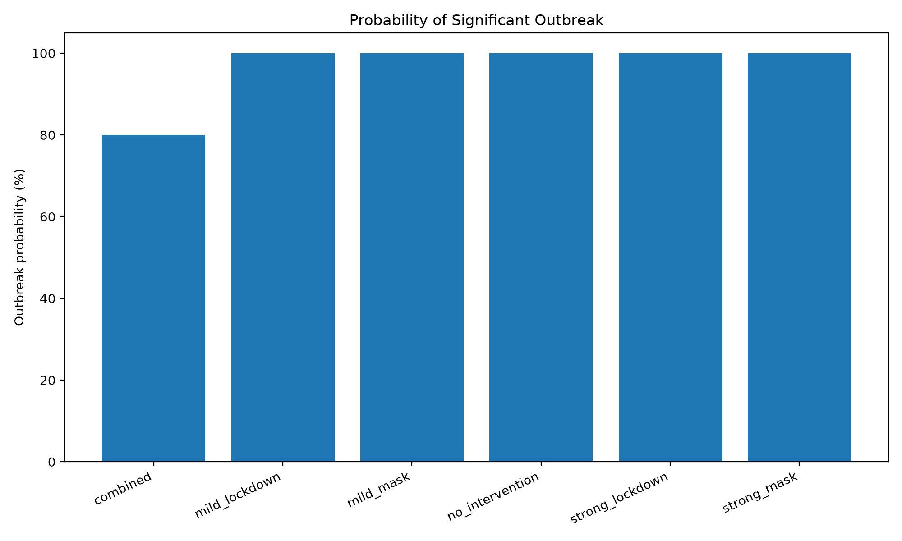
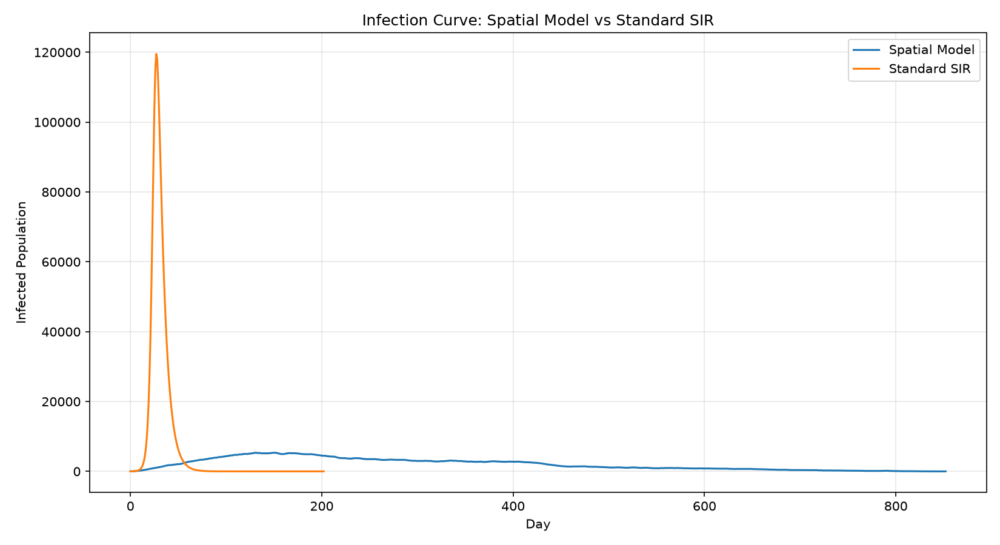
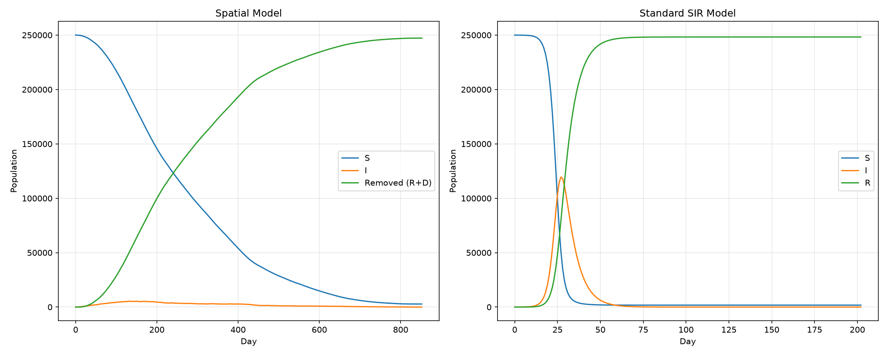

# Part E: Epidemiological Analysis of Pandemic Simulation

## 1. Introduction

The objective of Part E is to study the epidemiological behaviour of the pandemic simulation under different conditions. The experiments investigate how infection rate, vaccination, masks, and lockdown measures affect the spread of infection.

The simulation is also compared with a standard deterministic SIR (Susceptible-Infected-Recovered) mathematical model to understand the differences between spatial agent-based simulations and well-mixed population models.

The experiments focus on the following aspects:

- Baseline epidemic behaviour without interventions.
- Effect of varying the infection rate (beta).
- Effect of vaccination coverage and estimation of an empirical herd-immunity threshold.
- Effect of masks and lockdown measures.
- Comparison with standard SIR equations.

## 2. Simulation Model and Experimental Setup

### 2.1 Population and Grid

The simulation uses a two-dimensional grid.

The parameter `N` represents the side length of the grid, rather than the total population.

For the experiments:

- Grid size: 500 x 500
- Total population: 250,000 individuals
- Initial infected individuals: 10
- Infection duration: 7 days
- Default infection rate: 0.08
- Default death probability: 0.01
- Maximum simulation duration: 1000 days for parameter sweeps

Each individual can be in one of the following states:

- S: Susceptible
- I: Infected
- R: Recovered
- V: Vaccinated
- D: Dead

The simulation tracks the number of individuals in each state over time.

### 2.2 Infection Model

The infection probability depends on the number of infected neighbours.

The simulation considers the eight surrounding cells (Moore neighbourhood).

If an individual has `k` infected neighbours, the probability of infection is:

P(infection) = 1 - (1 - beta_eff)^k

where beta_eff is the effective infection rate after applying intervention factors.

Masks reduce the effective infection rate:

beta_eff = beta * mask

When lockdown is active, the effective infection rate is further multiplied by the lockdown factor:

beta_eff = beta * mask * lockdown_factor

### 2.3 Reproducibility

Multiple random seeds are used for each experimental setting.

For the beta, vaccination, and intervention experiments, 10 independent seeds were tested per configuration.

The results are reported using:

- Average peak infected population.
- Standard deviation of peak infected population.
- Average day on which the peak occurs.
- Average epidemic duration.
- Average attack rate.
- Outbreak probability.

The standard deviation represents variation across the independent random-seed runs.

### 2.4 Outbreak Definition

For consistent comparison, an outbreak is operationally defined as an attack rate of at least 1%.

Attack rate is calculated as:

Attack Rate = (Recovered + Dead + Currently Infected) / Total Population

For a population of 250,000, the 1% threshold corresponds to 2,500 individuals.

This is an experimental definition used for this analysis, not a universal epidemiological definition.

---

## 3. Baseline Epidemic Behaviour

A baseline simulation was performed without vaccination, masks, or lockdown.

### Configuration

| Parameter | Value |
|---|---:|
| Grid size | 500 x 500 |
| Population | 250,000 |
| Initial infected | 10 |
| Infection rate | 0.08 |
| Infection duration | 7 days |
| Death probability | 0.01 |
| Vaccination | 0 |
| Mask factor | 1.0 |
| Lockdown factor | 1.0 |
| Random seed | 42 |

### Results

| Metric | Result |
|---|---:|
| Epidemic duration | 852 days |
| Peak infected population | 5,351 |
| Day of peak infection | 131 |
| Final susceptible | 2,780 |
| Final recovered | 244,629 |
| Final dead | 2,591 |
| Final infected | 0 |

The infection initially spreads slowly because only a small number of individuals are infected. As the infection reaches more susceptible individuals, the infected population increases and eventually reaches its peak.

After the peak, the number of infected individuals decreases as individuals recover or die. The epidemic ends on Day 852 when no infected individuals remain.

### Baseline Plot

**Observation:** The baseline experiment provides a reference for evaluating the effectiveness of vaccination, masks, and lockdown measures.

---

## 4. Effect of Infection Rate (Beta)

The infection rate controls the probability of transmission between susceptible and infected individuals.

Six different beta values were tested:

0.02, 0.04, 0.06, 0.08, 0.10, and 0.12.

For each beta value, 10 independent random seeds were used.

### 4.1 Experimental Results

| Beta | Average Peak Infected | SD of Peak | Average Peak Day | Average Attack Rate | Outbreak Probability | Completed Runs |
|---:|---:|---:|---:|---:|---:|---:|
| 0.02 | 22.3 | 3.20 | 6.0 | 0.02% | 0% | 10/10 |
| 0.04 | 626.9 | 144.99 | 578.0 | 20.66% | 100% | 0/10 |
| 0.06 | 4,473.1 | 672.11 | 237.6 | 94.40% | 100% | 6/10 |
| 0.08 | 6,178.0 | 727.30 | 180.0 | 98.88% | 100% | 10/10 |
| 0.10 | 7,471.2 | 869.53 | 145.0 | 99.69% | 100% | 10/10 |
| 0.12 | 8,405.8 | 937.50 | 130.6 | 99.91% | 100% | 10/10 |

*SD represents sample standard deviation across the 10 runs.*

### 4.2 Observations

1. At beta = 0.02, the infection remains limited and does not reach the defined 1% outbreak threshold.
2. At beta = 0.04, all 10 runs cross the outbreak threshold, but none finish within the 1000-day simulation limit.
3. At beta = 0.06, the average peak infected population increases significantly.
4. At beta = 0.08, 0.10, and 0.12, all 10 runs complete within the simulation limit.
5. Increasing beta generally increases the peak infected population and advances the peak to an earlier day.

The tested values suggest that the outbreak transition under the chosen 1% criterion lies between beta = 0.02 and beta = 0.04.

A finer parameter sweep would be required to estimate the transition more precisely.

**Important limitation:** Some runs at beta = 0.04 and beta = 0.06 were still active at Day 1000. Their reported durations are therefore limited by the simulation cap and should not be interpreted as complete epidemic durations.

---

## 5. Effect of Vaccination

Vaccination reduces the number of susceptible individuals who can become infected.

Vaccination coverage was varied from 0% to 90%, in increments of 10%.

Each vaccination setting was tested using 10 independent random seeds.

All other parameters were kept at the baseline values:

- Population: 250,000
- Beta: 0.08
- Mask factor: 1.0
- Lockdown factor: 1.0
- Initial infected: 10

### 5.1 Experimental Results

| Vaccination | Average Peak Infected | SD of Peak | Average Peak Day | Average Attack Rate | Outbreak Probability | Completed Runs |
|---:|---:|---:|---:|---:|---:|---:|
| 0% | 6,178.0 | 727.30 | 180.0 | 98.88% | 100% | 10/10 |
| 10% | 5,079.0 | 761.70 | 202.1 | 87.90% | 100% | 10/10 |
| 20% | 3,662.4 | 442.81 | 259.7 | 75.59% | 100% | 8/10 |
| 30% | 1,585.9 | 226.06 | 468.6 | 51.16% | 100% | 0/10 |
| 40% | 91.6 | 20.88 | 37.2 | 0.48% | 0% | 10/10 |
| 50% | 42.4 | 9.06 | 13.1 | 0.08% | 0% | 10/10 |
| 60% | 29.2 | 5.05 | 7.3 | 0.03% | 0% | 10/10 |
| 70% | 21.6 | 3.75 | 6.0 | 0.01% | 0% | 10/10 |
| 80% | 16.8 | 2.49 | 4.9 | 0.01% | 0% | 10/10 |
| 90% | 13.2 | 1.62 | 5.1 | 0.01% | 0% | 10/10 |

### 5.2 Observations

1. Increasing vaccination coverage consistently reduces the average peak infected population.
2. At 20% vaccination, the average peak is reduced from 6,178 to 3,662.4.
3. At 30% vaccination, the average peak decreases to 1,585.9, and the peak occurs substantially later.
4. At 40% vaccination, the average peak decreases to only 91.6 individuals.
5. At vaccination levels of 40% and above, none of the 10 runs reaches the operational 1% outbreak threshold.
6. At 50% and higher vaccination levels, the average peak infected population becomes very small.

### 5.3 Empirical Herd-Immunity Estimate

For the tested configuration, the transition from a significant outbreak to no significant outbreak occurs between 30% and 40% vaccination coverage.

- At 30% vaccination, outbreak probability is 100%.
- At 40% vaccination, outbreak probability is 0%.

Therefore, the empirical suppression threshold lies between 30% and 40% for this particular simulation configuration.

This is an experimental estimate, not a universal theoretical herd-immunity threshold. It depends on the infection rate, neighbourhood structure, initial conditions, and other simulation parameters.

### Vaccination Plots

---

## 6. Effect of Masks and Lockdown

This experiment investigates how masks and lockdown measures influence the epidemic.

Six configurations were tested, with 10 independent seeds per configuration.

### 6.1 Configurations

| Configuration | Mask Factor | Lockdown Factor | Lockdown On Threshold | Lockdown Off Threshold |
|---|---:|---:|---:|---:|
| No intervention | 1.0 | 1.0 | 1.0 | 0.0 |
| Mild mask | 0.8 | 1.0 | 1.0 | 0.0 |
| Strong mask | 0.5 | 1.0 | 1.0 | 0.0 |
| Mild lockdown | 1.0 | 0.7 | 0.02 | 0.005 |
| Strong lockdown | 1.0 | 0.3 | 0.02 | 0.005 |
| Combined | 0.5 | 0.3 | 0.0004 | 0.0001 |

The combined configuration uses lower lockdown activation thresholds so that lockdown can activate even after the mask has reduced the infected population.

### 6.2 Experimental Results

| Configuration | Average Peak Infected | Peak Reduction | Average Attack Rate | Outbreak Probability | Completed Runs |
|---|---:|---:|---:|---:|---:|
| No intervention | 6,178.0 | 0.00% | 98.88% | 100% | 10/10 |
| Mild mask | 4,840.9 | 21.64% | 96.06% | 100% | 6/10 |
| Strong mask | 626.9 | 89.85% | 20.66% | 100% | 0/10 |
| Mild lockdown | 5,036.8 | 18.47% | 95.45% | 100% | 6/10 |
| Strong lockdown | 5,234.9 | 15.27% | 94.72% | 100% | 7/10 |
| Combined | 104.5 | 98.31% | 2.20% | 80% | 3/10 |

### 6.3 Observations

**Masks**

- Mild masking reduces the average peak infected population by approximately 21.64%.
- Strong masking reduces the average peak by approximately 89.85%.
- Strong masking also reduces the average attack rate substantially.
- However, the strong-mask runs do not finish within the 1000-day limit.

**Lockdown**

- Both mild and strong lockdown configurations reduce the peak compared with the baseline.
- The dynamic lockdown mechanism activates when the infected fraction crosses the specified threshold.
- The timing of activation and deactivation influences the final epidemic trajectory.
- The results show that the relationship between lockdown strength and peak infection is not necessarily linear in a dynamic simulation.

**Combined intervention**

- The combined mask and lockdown configuration produces the lowest average peak infected population.
- The average peak is 104.5, compared with 6,178 in the baseline.
- This represents an average peak reduction of approximately 98.31%.
- The average attack rate is reduced to 2.20%.
- Three out of ten runs complete within the 1000-day limit.

The combined configuration demonstrates that multiple interventions can substantially reduce the epidemic peak.

However, 8 out of 10 runs still cross the operational 1% outbreak threshold, showing that reducing the peak does not necessarily eliminate the outbreak.

### Intervention Plots

---

## 7. Comparison with Standard SIR Model

The spatial simulation was compared with a standard deterministic SIR model.

The SIR model divides the population into three compartments:

- S: Susceptible
- I: Infected
- R: Recovered or removed

### 7.1 Standard SIR Equations

The standard continuous-time SIR equations are:

dS/dt = -beta * S * I / N

dI/dt = beta * S * I / N - gamma * I

dR/dt = gamma * I

where:

- S is the susceptible population.
- I is the infected population.
- R is the recovered population.
- N is the total population.
- beta is the transmission parameter.
- gamma is the recovery rate.

The recovery rate is calculated using the infection duration:

gamma = 1 / 7 = 0.142857

### 7.2 Parameter Selection

The spatial simulation uses eight neighbouring cells for infection transmission.

For comparison, an approximate effective SIR transmission parameter was selected:

beta_SIR = 8 * 0.08 = 0.64

This is a rough mean-field approximation based on the eight-neighbour structure. It is not an exact mathematical equivalence or a calibrated parameter mapping.

### 7.3 Standard SIR Results

| Metric | Result |
|---|---:|
| Population | 250,000 |
| Initial infected | 10 |
| Beta | 0.64 |
| Gamma | 0.142857 |
| Peak infected | 119,543.37 |
| Peak day | 27 |
| Simulation duration | 202 days |
| Final susceptible | 1,746.27 |
| Final recovered | 248,253.73 |

### 7.4 Comparison of Peak Infection

| Metric | Spatial Simulation | Standard SIR |
|---|---:|---:|
| Peak infected | 5,351 | 119,543.37 |
| Peak day | 131 | 27 |
| Population | 250,000 | 250,000 |
| Model type | Spatial and stochastic | Well-mixed and deterministic |

The standard SIR model produces a much larger and earlier infection peak than the spatial simulation.

The standard SIR peak is approximately 22.34 times the spatial simulation peak.

### 7.5 Interpretation

The difference is mainly due to the assumptions of the two models.

**Spatial simulation:**

- Individuals interact locally with their eight neighbouring cells.
- Infection spreads through spatial contact.
- Randomness affects the epidemic trajectory.
- The spatial distribution of infected individuals influences further transmission.

**Standard SIR model:**

- Assumes a well-mixed population.
- Every susceptible individual is effectively exposed to the overall infected fraction.
- Uses deterministic differential equations.
- Does not explicitly model spatial distance or local neighbourhoods.

The spatial model therefore restricts transmission through local interactions, while the standard SIR model assumes population-wide mixing.

The SIR model also has no separate death compartment. For the compartment comparison plot, spatial recovered and dead populations are treated together as removed individuals.

### SIR Comparison Plots

---

## 8. Overall Findings

The experiments provide the following important findings:

1. **Infection rate:** Increasing beta increases the average peak infected population and generally causes the peak to occur earlier.

2. **Vaccination:** Higher vaccination coverage significantly reduces the number of infected individuals. For the tested configuration, the empirical suppression threshold lies between 30% and 40%.

3. **Masks:** Strong masking reduces the average peak infected population by approximately 89.85% compared with the baseline.

4. **Lockdown:** Dynamic lockdown measures influence the peak and timing of infection. Their effectiveness depends on the activation and deactivation thresholds.

5. **Combined interventions:** Combining masks and lockdown produces the lowest average peak infected population in the experiments, with an average peak reduction of approximately 98.31%.

6. **SIR comparison:** The deterministic well-mixed SIR model produces a much earlier and larger peak than the spatial stochastic simulation under the selected approximate transmission parameter.

7. **Randomness:** Results vary across seeds, demonstrating why multiple independent runs are important for stochastic epidemic simulations.

---

## 9. Limitations

The experiments have several limitations:

1. Parameter sweeps use a maximum simulation duration of 1000 days. Some epidemics remain active at the end of this period.
2. The reported duration for incomplete runs is the observed simulation duration, not the complete epidemic duration.
3. The outbreak threshold of 1% is an operational definition selected for this analysis.
4. The estimated vaccination suppression threshold applies only to the tested parameter configuration.
5. The SIR transmission parameter of 0.64 is an approximate mapping from the eight-neighbour spatial model, not an exact calibration.
6. The standard SIR model does not explicitly represent deaths, vaccination, masks, lockdown, or spatial movement.
7. The experiments use a fixed population and do not model births, migration, or changes in population size.
8. The results depend on the random seeds and the model's assumptions.

---

## 10. Conclusion

Part E demonstrates how epidemiological outcomes change under different infection rates and intervention strategies.

The baseline experiment shows that an epidemic can spread through the population and eventually decline as susceptible individuals become infected, recover, or die.

Increasing the infection rate causes larger and earlier epidemic peaks. Vaccination substantially reduces the average number of infections, with the tested experiments showing a transition from significant outbreaks at 30% vaccination to no significant outbreaks at 40%.

Masking and lockdown measures also reduce the epidemic peak. The combined intervention configuration achieves the largest reduction in average peak infection, approximately 98.31% compared with the baseline.

Finally, comparison with the standard SIR model demonstrates the importance of spatial interactions. The well-mixed deterministic SIR model produces a substantially larger and earlier peak than the spatial simulation.

Overall, the experiments show that vaccination and combined non-pharmaceutical interventions can substantially reduce epidemic spread, while the choice of mathematical model and its assumptions strongly influence predicted epidemic behaviour.